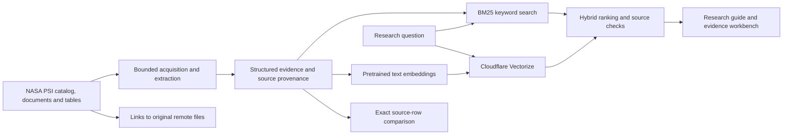

<p align="center"></p>

# flamingo

**Flame Learning & Analysis in Microgravity: INsights for Gravity-Off missions**

### From a research question to inspectable NASA evidence.

[Explore the live website](https://flamingo.flamingo-research.workers.dev/) · [Try the research collection](https://flamingo.flamingo-research.workers.dev/#explore) · [Learn through play](https://flamingo.flamingo-research.workers.dev/#learn)

flamingo helps people explore NASA combustion research without first downloading multi-terabyte experiment archives or knowing the exact scientific vocabulary. Ask a question, discover relevant investigations, inspect original excerpts and source rows, then compare or export the evidence.

This is the **public delivery repository**: application code, research backend, data snapshots, vector-index tooling, reproducible audits and an explanation of the engineering behind the website. The [working repository](https://github.com/Maran-sjmh/flamingo) remains the team's collaboration space. This delivery records a specific deployed snapshot; future work is identified separately.

## The problem we address

Useful evidence is spread across investigation descriptions, tables, workbooks, reports, publications and large media collections. Different experiments use different materials, units and conditions. A researcher needs to find the right source and understand its context before comparing values.

Our approach is to **index the evidence we can inspect and preserve links to the larger original collection**. A catalog entry or filename is never treated as proof that an unseen file was analyzed.

## What you can explore

| Experience | What it does |
| --- | --- |
| Research guide | Uses hybrid retrieval to suggest real investigations, cited excerpts and internal research routes. |
| Unified Explore feed | Brings investigations, original source rows and publication references into one searchable interface. |
| Investigation pages | Show context, source data, coverage, references, provenance and conservative numeric summaries. |
| Comparisons | Compare up to four investigation catalogs or two to six exact source rows; export CSV with qualifiers intact. |
| Curated reading room | Read two incorporated NASA PDFs with page-linked evidence. |
| Learn | Explore three schematic 3D habitats, an illustrated flame lab and a six-choice science mission. |

## The data behind the interface

| Included in this snapshot | Count |
| --- | ---: |
| NASA PSI investigations | **25**: 24 Combustion Science + 1 cabin-aerosol context investigation |
| Source tables represented | **22** |
| Nonblank source rows available | **2,009** |
| Indexed evidence items | **6,177** |
| Retrieval fragments / indexed vectors | **3,152** |
| Publication references | **364** |
| Remote asset references | **52,742** |
| Declared size of referenced remote files | **12.279 TB**, decimal |

The remote files are **not all downloaded or analyzed**. Bibliographic references are not all acquired full texts. Source rows are not automatically independently validated experiments. The two full-text PDFs are a separate curated collection, not the size of the research catalog. [Read the data scope](docs/DATA.md).

## What makes the approach useful

- **Search by meaning and by exact words.** A pretrained embedding model supports conceptual discovery; keyword search retains exact names, identifiers and numerical terms. Results are combined rather than forcing a single search method.
- **A large virtual corpus with a small inspectable core.** Keep metadata, selected structured data and evidence locally; access large original files through NASA source links when needed.
- **Traceable evidence.** Retrieval fragments preserve source identity, locators, original text and file hashes. The server resolves vector candidate IDs against its canonical corpus before returning source text.
- **Comparison that retains context.** Ranges such as `21.5 - 21.7`, approximations such as `~ 21.5` and signed values remain visible. Shared units alone do not establish scientific comparability.
- **One collection, different entry points.** Researchers can inspect source tables while students explore concepts and follow links to the same investigations.

These are integration and information-access contributions. We use a pretrained embedding model; we did not train a new combustion predictor.

## How it works



**Vector model:** BGE-small-en-v1.5, 384 dimensions, cosine similarity. **Hybrid ranking:** BM25 + reciprocal rank fusion. **Serving:** React/Vite frontend and Cloudflare Workers API, with Workers AI embeddings and Vectorize bindings. [Architecture](docs/ARCHITECTURE.md) · [Semantic search explained](docs/SEMANTIC_SEARCH.md).

The public guide performs live evidence discovery with deterministic framing and navigation. **Public paid GPT/Groq generation is disabled.** The backend contains gated generation adapters and a separately labeled historical evaluation; neither means unrestricted public scientific answers are enabled. [RAG and generation boundaries](docs/SEMANTIC_SEARCH.md#retrieval-rag-and-generation).

## Run the website

Use Node **24.x**, pnpm **11.25.0**, and npm for the separate Worker package.

```bash
git clone https://github.com/Maran-sjmh/flamingo-submission.git
cd flamingo-submission
pnpm install --frozen-lockfile
npm --prefix worker ci
pnpm dev
```

Open **http://localhost:5173**. The frontend uses the existing public research API by default; no model key is needed to explore the published experience. Public service limits still apply.

For a local lexical-only backend, set `VITE_API_BASE_URL=http://localhost:8787` in an ignored `.env.local`, restart Vite, and run `npm --prefix worker run dev` in another terminal. Local source-row comparison on `#rows` reads bundled data. The separate API comparison path uses the existing public Firestore source. [Full development and independent deployment](docs/REPRODUCIBILITY.md).

## Reproduce the evidence audit

Python **3.11+**, standard library only:

```bash
python research/audit_snapshot.py
python research/build_store.py
python research/build_corpus.py
node research/evaluate_retrieval.mjs
node research/vector_index.mjs plan
```

These commands check hashes and identities, rebuild a local SQLite snapshot, regenerate the retrieval corpus, replay recorded retrieval probes and describe the vector-ingestion plan. **They do not make model calls or write to Cloudflare.** The rebuilt SQLite store comes from the published snapshot; it is not a new acquisition of all original NASA files. Remote ingestion is a separate explicit operator action.

## Verify the application

```bash
pnpm test
npm --prefix worker test
pnpm build
pnpm run check:repository
```

The application checks cover **23 rendered routes**, the 25 source snapshots, original PDF evidence, source-value preservation, local comparisons, educational copy and guide behavior. The backend has **60 offline tests**. Scientific usefulness is a different validation question. [Validation, recorded probes and remaining gaps](docs/VALIDATION.md).

## Explore the repository

| Start here | Contents |
| --- | --- |
| [Architecture](docs/ARCHITECTURE.md) | Components, request flow and storage roles |
| [Data and provenance](docs/DATA.md) | Selection, schema, extraction, coverage and source identities |
| [Semantic search](docs/SEMANTIC_SEARCH.md) | Embeddings, vector index, hybrid ranking and RAG boundaries |
| [Reproducibility](docs/REPRODUCIBILITY.md) | Local setup, audits, recorded evaluation and independent deployment |
| [Demonstration](docs/DEMO.md) | Concrete paths through the actual product |
| [Validation](docs/VALIDATION.md) | Measured checks, small development probes and limitations |
| [Source attribution](THIRD_PARTY_NOTICES.md) | NASA data, media, dependencies and licensing scope |
| [Submission manifest](SUBMISSION_MANIFEST.json) | Working commit, deployed version and protected-source hashes |
| [Reports](reports/) | Versioned preparation, selection, evaluation and verification evidence |

## Status and attribution

This release is based on working commit `a4052b708f28e9d7f5126a4a491e78e47e42789f` and frontend version `1094fcda-3fb2-4b77-a592-36223d639adf`. Application source and scientific snapshots are preserved; deployment names are adapted for an independent checkout so a fork does not target the team's live Worker by default.

NASA supplies the underlying research. flamingo is an independent project and is not a NASA endorsement or safety certification. The 3D habitats and flame lab are educational illustrations. Browser visual/mobile/WebGL validation remains pending; automated render and HTTP checks do not establish it.

## Final submission hardening

The latest source adds a coordinated 250-attempt semantic budget per UTC day, explicit keyword fallback, restrictive browser/API headers and visible AI-assisted educational-illustration labels. Paid text generation stays disabled. See [security review](docs/SECURITY_REVIEW.md) and [AI-use disclosure](docs/AI_USE.md). This is a scoped review, not a guarantee against all service disruption.

The public hostname was migrated in v1.1.1. Replace old QR codes and saved links; historical reports and tags retain their original addresses. See [URL migration](docs/URL_MIGRATION.md).
