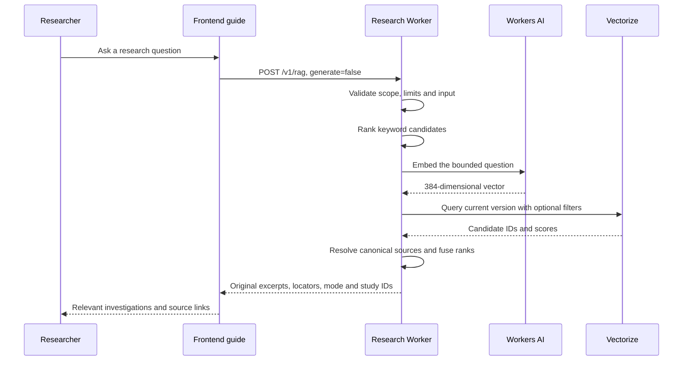

# Architecture

flamingo separates evidence discovery, source inspection, comparison and optional generation. This keeps a relevant-looking result from being presented as a scientific conclusion.

## Components and storage

| Component | Responsibility | Where to inspect it |
| --- | --- | --- |
| React/Vite application | Question-led home, collection, investigations, reading room, comparisons and Learn | `src/` |
| Published source snapshots | Original cell strings and provenance, loaded as needed | `public/data/rows/` |
| Investigation catalog | Titles, context, coverage, publications and snapshot hashes | `src/investigation-catalog.json` |
| Research Worker | Request limits, CORS, retrieval, source resolution, deterministic comparison and gated providers | `worker/src/worker.mjs` |
| Canonical retrieval corpus | Versioned fragments, exact text, source locators and evidence IDs | `worker/src/generated/retrieval-corpus.json` |
| Keyword index | BM25-style ranking over the canonical corpus, constructed in memory | `worker/src/retrieval.mjs` |
| Vector database | Candidate similarity search over 384-dimensional embeddings, with scope filters | Cloudflare Vectorize binding `NASA_VECTORS` |
| Embedding service | Uses the same pretrained model and pooling for source fragments and questions | Workers AI binding `AI` |
| Existing public Firestore source | Reloads original row cells for the backend comparison endpoint | `worker/src/firestore.mjs` |
| Reproducible SQLite snapshot | Local audit/research artifact; not the browser database or deployed vector store | `research/build_store.py` |

The original acquisition workspace had a larger SQLite evidence store with source inventories and extraction records. The public repository rebuilds a smaller relational snapshot from its included evidence. These are distinct from the deployed Vectorize index and the Firestore source service.

## A question through the application

The vector service supplies candidate IDs, not trusted public source text. The Worker resolves those IDs against its canonical corpus, rejects unknown or out-of-scope matches, and returns original cited excerpts. The frontend uses known investigation routes rather than model-invented destinations.

## Two comparison paths

The main `#rows` page loads published per-investigation JSON snapshots and compares two to six selected rows in the browser. It retains original strings, supplied classifications, review flags and source hashes, and exports CSV. This path works without the research API.

The NASA evidence workbench also offers an API comparison path. The Worker reloads selected source cells from the existing public Firestore data and applies its exact-value contract. It is separate from semantic ranking and from optional generation.

Investigation comparison (`#versus`) shows metadata and coverage for up to four investigations. File counts and indexed-fragment counts describe coverage, not experiment quality or scientific performance.

## Runtime and deployment

The live frontend is a static Cloudflare Worker. A separate Worker serves the research API and uses Workers AI and Vectorize bindings. CORS accepts exact configured origins and localhost; it is not authentication. Existing rate-limit bindings are approximate per Cloudflare location, not a strict worldwide spending cap.

The delivery repository has independent Worker names and no account ID in deployment configs. Its local backend disables semantic search and generation. Independent semantic deployment requires your own index, model access, exact frontend origin and API URL. Publishing this source repository does not redeploy the team's application or database.

## Educational and media layer

NASA footage and source figures retain their context. Three.js is loaded on demand for the Learn section; its habitats are schematic code-generated scenes, not engineering models. The flame lab uses qualitative drawing rules and game cutoffs. Neither activity predicts validated lunar/Martian combustion behavior.

## Optional generation

OpenAI and Groq adapters are retained for the separately gated generation path. Public generation is disabled. Existing recorded evaluation output is explicitly labeled. Text selection and numerical checks constrain output, but they do not prove scientific interpretation or relevance. See [semantic search](SEMANTIC_SEARCH.md) and [validation](VALIDATION.md).
