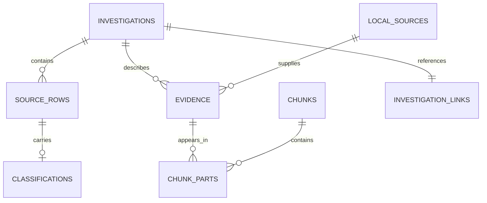

# Data, provenance and the virtual corpus

## Source selection

NASA's Physical Sciences Informatics (PSI) repository is the main source. The captured catalog-selection step reviewed 133 entries and selected 24 labeled Combustion Science plus PSI-179, a Complex Fluids–Soft Matter investigation included for cabin-aerosol context. This is a captured selection, not a claim about NASA's current total catalog. See [selection evidence](../reports/catalog-selection.json) and [NASA PSI](https://psi.nasa.gov/physci/repo).

The application combines prepared metadata with a captured retrieval corpus. Later metadata updates do not automatically reindex earlier evidence. Version hashes and explicit source boundaries matter.

## Coverage layers

| Layer | Included | Interpretation |
| --- | --- | --- |
| Investigation catalog | 25 entries | Named research projects, not individual tests or papers |
| Table snapshots | 2,009 nonblank rows from 22 tables | Source strings and annotations, not automatically validated independent experiments |
| Earlier table acquisition | 2,870 rows including 861 blank rows | Blank rows are excluded from the browsing/retrieval snapshot |
| Evidence corpus | 6,177 items, grouped/split into 3,152 fragments | Available extracted text and cells only |
| Publications | 364 bibliography entries | Full texts are not all acquired or indexed |
| Remote registry summary | 52,742 references; 12,279,107,413,131 declared bytes | Pointers and reported sizes, not downloaded or analyzed contents |
| Curated reading room | 2 PDFs, 75 pages, 47 extracted records, 6 illustrated configurations | Separate document collection; no invented one-to-one assignment to PSI investigations |

The deployed browser catalog contains per-investigation remote summaries and source links. It does not ship a complete downloadable 52,742-file registry or proxy every NASA asset. The earlier acquisition workspace had a remote registry with an earlier incomplete count; it must not be confused with the later published metadata snapshot.

## Acquisition and extraction

The original development pipeline queried public NASA catalog/metadata/inventory endpoints and processed selected small source tables, documents and workbook cached cells. This was structured API-based acquisition and controlled extraction, not a download of the entire archive. Original source bytes were retained in the acquisition workspace with hashes and extraction information.

Table adapters preserved cell strings and source locations while applying documented surrounding-whitespace normalization. The published row snapshots preserve those adapted strings; they do not claim byte-identical original CSV formatting. One source encoding and legacy parser issues were tracked rather than hidden by a broad normalization pass.

The public repository includes the resulting inspectable snapshots and the retrieval corpus. Its reproducible SQLite reconstruction and chunk builder operate on those included artifacts; they do not rerun the original live NASA acquisition or reproduce unavailable media.

## Identifiers and provenance

| Identifier | Purpose |
| --- | --- |
| Accession, for example `PSI-98` | Investigation identity |
| `test_uid` | Historical field name for accession + source file + row number; not a scientific certification |
| `evidence_id` | Identity of an extracted original text/cell item |
| `source_id` | Original source identity used by extraction and retrieval |
| `locator` | File row, worksheet cell or other exact source location |
| `source_sha256` | Hash of the recorded source file |
| `rows_sha256` | Hash of the published per-investigation row snapshot |
| Corpus version | Hash of the embedding configuration and canonical fragments |

The snapshot audit reconstructs each evidence item from fragment offsets, checks continuity and conflicting duplicate parts, validates fragment identities and the corpus version, and verifies the included application/source hashes. This demonstrates artifact integrity, not that a source's numerical values are scientifically correct.

## Rebuilt local database

`research/build_store.py` reconstructs a local SQLite snapshot with source rows, canonical fragments, original evidence strings, source identities and annotations. It is deliberately regenerated outside Git. `research/build_corpus.py` then reruns the original grouping/splitting algorithm against that reconstructed evidence and checks the resulting version against the shipped corpus.

The vector database is a separate index built from these fragments. A normal structured row store remains necessary for exact numeric comparisons and provenance.

## Comparison and numeric summaries

`21.5 - 21.7`, `~ 21.5`, `<1`, negative values and missing markers are kept as original strings. The chart parser accepts only complete finite numeric cells, groups by source table and supplied row label, and leaves ranges/qualifiers as text. No automatic unit conversion or causal interpretation is inferred by the charts.

Matching units, shared microgravity or a visually similar flame do not establish equivalence. Fuel, geometry, pressure, oxygen location, gravity, flow, calibration and measurement method require source review.

## Known gaps

PSI-68's remote inventory remains incomplete although local rows are available. The historical provenance review has 43 unresolved aggregate warnings. Supplied row classifications have limits. Bibliography entries are not full-paper findings. Orbital experiments are not automatically lunar or Martian evidence. [Validation and limitations](VALIDATION.md) records these boundaries.
